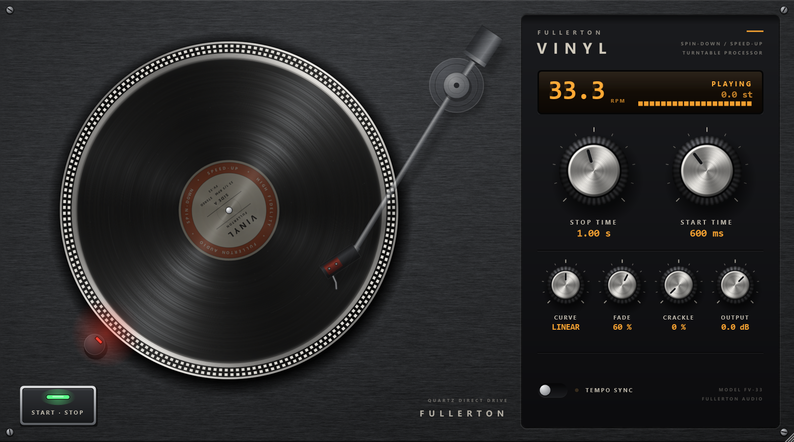
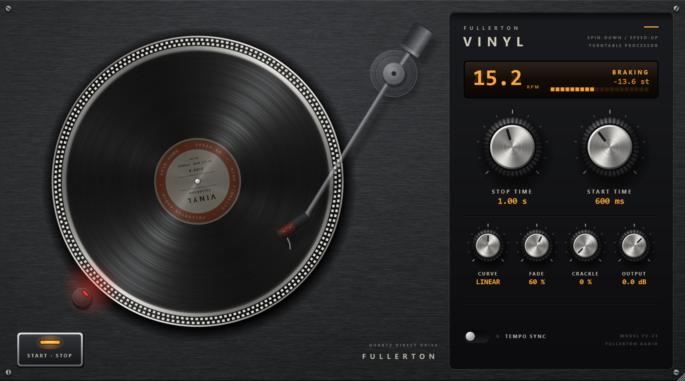

# Fullerton Vinyl: Turntable Spin-Down / Speed-Up (VST3)

A turntable stop/start effect, written in C++20 with [JUCE](https://juce.com) and CMake. Press **Start · Stop** and the audio winds down like a record when the motor cuts out. Press it again and it spins back up to speed. Every control can be automated, so you can time slow-outs and rise-ins to the arrangement. The whole UI (deck, platter, record, tonearm and knobs) is rendered in code, with no bitmap assets.



*Rendered by the project's own snapshot tool.*

## Download

Get the latest Windows VST3 from the [Releases page](https://github.com/crfguitar/Fullerton-Vinyl/releases/latest). Extract the zip, copy the `Fullerton Vinyl.vst3` folder into `C:\Program Files\Common Files\VST3`, then rescan plug-ins in your DAW. The plug-in isn't code-signed, so Windows may warn the first time it loads.

## Features

### Sound

- **Real platter physics, not pitch-shifting.** The input always goes into a delay line, and a read head moves through it at platter speed. Pitch and tempo drop together, the way they do on a real deck.
- **Bit-exact when running.** While the platter is at full speed the output is identical to the input, with zero latency.
- **Stop and start times** from 50 ms to 10 s, or **tempo-synced** to 1/16 up to 4 bars.
- **Curve** shapes the ramp, from a fast-then-slow brake to a slow-then-fast one, with Linear in the middle. Reversing mid-ramp keeps the speed continuous, so you can toggle quickly without clicks.
- **Fade** sets how much the level follows the speed. **Crackle** adds surface noise that slows down with the record. **Output** ranges from −24 to +12 dB.
- **Click-free throughout.** Interpolation blends from linear to Catmull-Rom as the read head leaves the live signal. A gain smoothstep stops a DC offset from being held at standstill. A 40 ms equal-power crossfade relocks to the live input after spin-up.

### UI and workflow

- **Procedurally rendered deck.** Brushed-metal plinth, spun-aluminium platter with strobe dots that stand still at 33⅓, a record with moving reflections, a tonearm and machined knobs, all drawn per pixel at 2× and resizable.
- **Live display** of RPM, pitch offset in semitones, and state (playing / braking / stopped).
- **Host automation from any control.** Right-click any knob or button to open the host's parameter menu (for example, to create an automation clip in FL Studio).



## Testing and dev tooling

`VinylDevTool` runs the DSP and processor tests, then renders the editor to PNG, so you can check both without a DAW:

```sh
build/VinylDevTool_artefacts/Release/VinylDevTool.exe <output-folder>
```

| Area | What it checks |
| --- | --- |
| DSP, at three curve settings | Bit-exact passthrough when running. Braking and spin-up finish on time. Brake, landing, spin-up and relock are click-free (largest sample step is reported). Silence when stopped. No NaN or Inf |
| Stress | Random start/stop toggling with crackle stays finite and bounded. Repeated long partial ramps stay inside the delay line |
| Processor | 600 blocks of random automation stay finite. State save/restore round-trips |
| Snapshots | Writes `gui-playing.png`, `gui-braking.png` and `gui-stopped-sync.png` (the screenshots above) |

## Building

Requirements: Windows, Visual Studio 2022, CMake ≥ 3.22, and a local JUCE checkout.

```sh
cmake -S . -B build -G "Visual Studio 17 2022" -A x64 -DJUCE_DIR=C:/path/to/JUCE
cmake --build build --config Release
```

Outputs:

- `build/FullertonVinyl_artefacts/Release/VST3/Fullerton Vinyl.vst3`. A post-build step also copies it to `C:/Program Files/Common Files/VST3` (turn this off with `-DFV_COPY_PLUGIN=OFF`).
- `build/FullertonVinyl_artefacts/Release/Standalone/Fullerton Vinyl.exe`
- `build/VinylDevTool_artefacts/Release/VinylDevTool.exe`

## Project layout

```text
Source/
  DSP/VinylEngine.h     header-only engine: delay line, platter state machine, ramps, crackle
  PluginProcessor.*     JUCE processor, parameters, state
  PluginEditor.*        layout (1040×580 reference, scaled) and 60 Hz animation
  UI/Skin.*             procedural rendering of every bitmap
  UI/Widgets.*          Knob, StartStopButton, SlideSwitch, Display
tools/
  DevTool.cpp           tests and PNG snapshots
```

## Limitations

- The platter never goes faster than 33⅓, so there's no 45 rpm or pitch-up. This also means resampling only ever stretches the audio, so no anti-aliasing filter is needed.
- Spin-up ends a little behind the live signal (it can't read the future), so the relock crossfade jumps the timeline slightly. That jump is built into how this effect works.

## License

[GNU AGPL v3](LICENSE), in line with JUCE's open-source license.
